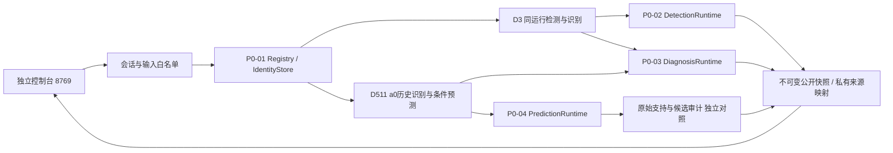

# S1：独立 AI 证据基础建设实施与验收报告

日期：2026-11-16，Asia/Hong_Kong。范围仅为 S1。没有接入 DeepSeek，没有读取真实 API Key，没有调用付费 API，没有进入 S2—S5 或 P0-05。

## 1. 交付结果和边界

已新增独立本机证据服务和控制台，地址 **http://127.0.0.1:8769/**。采用现有 Python 环境、标准库 HTTP 服务和原有冻结运行时，前端为独立静态 HTML/CSS/JS。未修改原七页或 frontend/dist，未修改或启动8768服务。

已实现：随机案例目录、严格输入合同、D3/D511隔离、实际检测/识别/预测调用、原始审计引用、应用层不可变证据快照、证据与运行身份私有映射、时间截断、知识目录、版本化提示词政策、Claim Schema及验证器、会话与CSRF隔离、只读证据追溯、本地控制台。

最终测试 **27通过，0失败**（tests_final.xml / tests_final.log）。真实8769 HTTP验收完成两条数据链的计算和回读。没有用历史数值替代推理，没有把Mock作为模型结果。

验收限制必须保留：8768在本轮前后都无法连接，不能宣称完成“运行中的原站响应一致性”验证；原站文件完整性通过单独全量SHA256核验。控制台完成HTTP静态资源、CSP、JS语法和接口验收，尚未完成真实浏览器中的视觉、点击与响应式人工验收。因此不宣称所有验收维度均已完全通过。

## 2. 新增文件与目录

业务源码修改数量为0。新增实现全部位于独立包 `src/causalverse/evidence_s1/`：

|新增文件|用途|
|---|---|
|__init__.py|S1包边界|
|service.py|P0适配、身份映射、字段白名单、快照、证据及Claim验证|
|gateway.py|独立loopback HTTP服务、会话/CSRF/Host/Origin、端口独占|
|protection.py|8992项累积保护及未登记范围检查|
|knowledge.json|知识目录、提示词政策版本、Claim JSON Schema|
|console/index.html|独立证据控制台|
|console/style.css|离线工业风样式及小屏布局|
|console/app.js|真实调用、结果展示、完整证据展开|
|README.md|启动、测试、接口、运行与限制说明|

新增测试：`s1_tests/test_evidence_service.py`、`s1_tests/test_additional_boundaries.py`。新增只读HTTP验收工具：`s1_tests/capture_live.py`；新增交付清单封存工具：`s1_tests/seal_delivery.py`。新增本报告 `AI_PHASE3_S1_REPORT.md`。

唯一正式验收批次：`artifacts/ai_s1_acceptance/s1_20261116_102936_452b6431/`。不同测试轮次使用该批次内独立子目录，保留首次失败、修复前后结果、原始推理JSON/NPZ、真实HTTP响应、JUnit与日志。

当前独立服务运行批次：`artifacts/ai_s1_runs/12c54290c1a5588968bad2185bde917d/`。运行产生的每条P0推理均保存于该目录的 `_private/inference/`；后台身份在 `_private/cases.json`、`_private/mappings/`；公开快照在 `snapshots/`。私有目录没有HTTP挂载。

完整递归新增文件清单及逐文件SHA256见验收目录的 `new_files_inventory.json`，其自身摘要见 `inventory_seal.json`。清单为交付时刻快照；控制台之后的新请求只向当前运行批次追加新文件，不覆盖历史清单或旧证据。

## 3. 调用关系与真实计算证明



Registry只读恢复原模型；ObservationReader复用原始白名单、原始与processed核对、来源哈希与时间切片。P0模块未复制、未修改。D3测试80运行和D511测试80个a0历史条件进入随机目录，共160条。随机打乱顺序及随机别名，不对外暴露带故障编码的原始运行名、种子、manifest路径、parent/snapshot身份。

`actual_calls.json`记录受监视的一次双链调用：DetectionRuntime.detect 1次、DiagnosisRuntime.diagnose 6次、PredictionRuntime.predict 2次；同时阻断fit、fit_transform、calibrate、minimize、set_control、inject_fault，观察到的禁止调用为空。此为S1调用链证明，不冒充重新执行P0-02的80运行或P0-04的480条件全量验收。

### 3.1 实际8769 HTTP证据

`live_after.json`包含完整公开响应，可回溯到服务批次的后端原始计算产物：

|链|随机context_id|实际结果|
|---|---|---|
|D3|e9ce793e52d4de3f4ca1752444e5c4a8|as_of=5400，21个可用检测时刻；Static、VAR、Logistic全部INFERRED|
|D511|8cb99c24ea62ef33bb214ccbbb7a903a|三种机制识别INFERRED；Action、Delta各三动作INFERRED|

D3该快照末时刻5400：T²=34.04130168083059，SPE=7.871654552122939，Threshold score=0.959613061944394。完整投影、41变量贡献及Boolean报警保存于证据。21个时刻是按as_of真实截断的结果，没有补足到未来70个时刻。

D511每条路线保存成员数组(3,20,6,3)、均值及上下界(3,6,3)、完整候选成员(3,4,20,6,3)。三种动作0/1/5，固定120秒，六时域及三目标完整。Delta沿用冻结Base模型，未使用未来a0真实轨迹。

Action joint q=5.787873695670726；Delta joint q=5.971070267917241。两路线历史对照均MATCHED，仍采用rtol=atol=1e-12。档案比较在真实计算完成后执行，没有将档案prediction输入计算。详细绝对误差由原P0运行时compare_archive计算，本阶段公开摘要仅给出MATCHED，不冒充新的480组最大误差统计。

### 3.2 原始审计与五种状态

预测首先运行P0-04真实数值计算，再由Registry白名单读取 `candidate_disagreement.json` 和 `support_results.json` 的相同行。私有原身份只用于历史审计索引；不用于选择成员、候选模型或改变预测权重。对外保留原supported/reasons、base_support及normalized_range，并明确AUDIT_ONLY。`original_audit_matches_recomputation`要求原P0完整对照MATCHED。

本次HTTP样例六个路线/动作组合全部UNSUPPORTED和INTERVAL_TOO_WIDE；没有删除或改写。computation_status=COMPLETED、contract_valid=true、support_status、uncertainty_status、optimization_allowed=false独立保留。coverage_status=NOT_EVALUATED_ONLINE，递归谱半径标记NOT_APPLICABLE_DIRECT_FINITE_HORIZON。候选分歧不是可信概率，不产生最优动作排序或执行建议。

## 4. Evidence Context、时间和安全合同

POST /api/contexts仅接受selection_id、as_of、window三项。as_of必须为整数，D3范围0..14399、D511范围0..6120；window限180/600/1800。拒绝额外路径、真实run_id、故障标签、上传观测、API Key等字段。浏览器无法指定配对身份、模型参数、动作幅度、预测起点或持续时间。

识别沿用3600固定起点与原始切片；窗口结束前WAITING，结束时才INFERRED。预测沿用5340..5390历史、5400起点及原动作前command核对。未完整的数据不插值。D511不套用D3检测，D3不借用D511预测，均返回UNAVAILABLE及范围原因。

公开字段为手工白名单：模型ID/参数哈希、数值、候选及拒绝、时刻、固定合同、独立审计、随机证据ID和payload_sha256。真实运行身份、data_ref、源文件路径、原始source_file_hash映射、P0 inference_id及源摘要保存在后端。每项证据绑定context_id。每个快照以排他新建写入，映射记录完整快照SHA256，回读重算；返回副本，外部不能修改已保存对象。

此为应用层不可变和篡改检测，不是操作系统WORM或第三方签名。具备项目磁盘写权限的人可以破坏文件；不能据此宣称抵御拥有同机账户权限的攻击者。测试有意破坏的仅为新建临时测试快照，保留该失败样本及拒绝验证，未动历史文件。

候选类别编号是模型假设空间，不是暴露实际故障标签。评分不作为概率；单一候选不作为确定物理根因。未来预测时间明确标记CONDITIONAL_PREDICTION_NOT_FUTURE_TRUTH，不能与观测时间混淆。没有把历史仿真称为现场实时数据。

## 5. 知识、提示词和Claim基础

knowledge.json包含K01检测、K02机制、K03预测、K04研究边界，版本s1-knowledge-1。提示词政策s1-evidence-policy-1存于同文件；每个快照绑定该文件SHA256及政策版本。

Claim只允许context_id、evidence_id、claim_type，禁止额外数值或自由生成控制内容。验证器校验同一会话、同一context的证据归属，INFERRED仅允许COMPUTATION_AVAILABLE，非INFERRED仅允许INSUFFICIENT_EVIDENCE。跨上下文引用拒绝。这是S1最小Claim合同；不是完整自然语言事实验证器，没有实现LLM回答、报告生成或因果解释。

## 6. HTTP与本地部署限制

标准库ThreadingHTTPServer绑定127.0.0.1，Windows使用SO_EXCLUSIVEADDRUSE，端口占用直接失败，不杀进程、不自动换端口。启动先绑定保留端口并核验保护集合，完成模型加载后开始服务。校验期间连接可能等待/失败；应等待终端输出URL后使用。

会话Cookie HttpOnly/SameSite=Strict；POST必须有CSRF；Host/Origin限定本服务；无CORS开放。快照与证据按会话归属读取。资源使用固定路由，无目录遍历/私有目录/控制/文件上传接口。CSP仅同源，无CDN；错误对外脱敏。请求体4KB、单并发计算、128会话及128上下文、10秒socket读取超时。拒绝重复JSON键。

仍属单机研究服务：没有TLS、用户账户、会话过期回收、磁盘配额或强制中断模型计算的超时。重启会话及在线索引不恢复，但旧证据文件保留。不是互联网生产服务。没有完整HTTP访问日志以避免记录敏感请求；模型推理的准入、耗时、参数与来源记录在私有产物中。

## 7. 测试内容和结果

|实际测试|结果|
|---|---|
|真实三个P0入口与禁止训练/校准/控制调用监视|通过；1检测、6识别、2预测；禁止调用0|
|Action/Delta完整20成员、四候选20成员、joint档案及原审计对照|通过；两路线MATCHED；拒绝与过宽保留|
|公开字段排除真实身份、路径、future_truth、RNG及隐藏执行器信息|通过|
|源轨迹SHA256、后端映射、证据ID和数值输入摘要|通过|
|三个窗口各结束前1秒与完整时刻|通过；三方法WAITING→INFERRED|
|D511预测5399秒未完成|通过；两路线WAITING|
|D3和D511未来观测在内存副本大幅扰动|通过；当前检测/识别/预测数值逐项相等；未改原文件|
|模型调用实际NPZ键白名单、阻断外网socket连接|通过；实际调用INFERRED；访问键记录accessed_npz_keys.json|
|观测时刻不超过as_of|通过|
|D3/D511隔离及错误数据链合同拒绝|通过|
|负时间、Boolean时间、越界时间、非法窗口/选择、额外路径/未来真值/Key字段|全部拒绝|
|跨会话读取、跨context Claim、篡改快照、伪造预期源哈希|全部拒绝；只用新测试数据或内存映射|
|无Key、HTTP创建/回读、CSRF、恶意Origin、私有路径、控制路由|通过|
|端口重复占用|修复Windows默认复用后通过|
|控制台资源/CSP及JS语法|通过；没有浏览器视觉验收|
|原8768在线HTTP前后|均UNAVAILABLE；在线一致性无法验收，未主动启动或更改|

测试日志不只记录数量：tests_final.log逐项列出27项；tests_final.xml为机器可读明细；实际P0产物和公开快照保存于各独立子批次。控制台真实HTTP响应见live_after.json。

失败记录全部保留：tests.log为21通过+1沙箱WinError10013；tests_network.log为21通过+1端口可重复绑定缺陷；tests_exclusive.log为修复后22通过；tests_final.log为补充后27通过。一次正式服务校验尚未结束时过早发起HTTP验收，出现连接重置；待启动URL出现后重试成功。没有将这些首次失败归为通过，也未删除失败样本。

## 8. 文件保护

继承P0-04 protected_expected.json的7509项，再合并P0-04新增清单1481条及清单自身，得到8991；加接入方案得到8992。已包含用户确认保留的P0-02副本。P0-04清单SHA256锚5a2e324da592145a3f8e01145f175700e5dd484912db4f23c3f5b4d3a87f7a5b；方案SHA256为1861def8ed90acc2f6082829d635629e7b9b66af9b71c9b92275baa2861c3645。

启动前全量核验见运行批次protection_start.json：8992项，differences=[]，unknown=[]。交付前完整逐文件复查见验收批次protection_final.json；应以该文件实测结果为准，出现差异必须停止，不能依赖本报告文字判定通过。该记录同时包含每项预期SHA256。没有更新历史清单，没有重新训练/校准/仿真/安装依赖，没有改数据库或设备参数。

## 9. 完整复现命令

现有环境，项目根目录PowerShell：

```powershell
$env:PYTHONPATH=(Resolve-Path src).Path
.\.research\venv-tep\Scripts\python.exe -B -m causalverse.evidence_s1.gateway
```

已启动时重复命令应因端口占用失败；使用当前8769即可，停止仅对本旁路所在终端Ctrl+C。不要停止/启动8768。

```powershell
$env:PYTHONPATH=(Resolve-Path src).Path
$batch=Join-Path (Get-Location) ('artifacts/ai_s1_acceptance/replay_'+[guid]::NewGuid().ToString('N'))
$env:S1_ACCEPTANCE=$batch
.\.research\venv-tep\Scripts\python.exe -B -m pytest s1_tests -v -p no:cacheprovider --basetemp "$batch/tmp" --junitxml "$batch/tests.xml"
.\.research\venv-tep\Scripts\python.exe -B s1_tests/capture_live.py --sidecar --output "$batch/live.json"
```

输出目录每轮必须唯一；不得覆盖正式证据。测试需允许127.0.0.1回环网络；不需要API Key或外网。

## 10. 尚未实现与剩余风险

没有DeepSeek客户端、流式生成、自然语言助手、自动诊断报告、对话历史、工具调用、LLM事实校验、费用计量或七页接入。知识目录是筛选后的政策基础，未实现动态因果路径检索；不宣称当前运行因果图已经重新识别。

未在S1重跑全部P0数值全集；S1重点验证封装真实性、边界和可追溯性，历史P0验收保持原结论。IDV(14)稳定性、候选分歧、宽区间、支持不足等既有研究风险未解决。计算成功不代表干预可信。

下一步仅建议在审核中补充真实浏览器视觉/点击验收及8768在线可用性验证，并审定更完整的Claim词表与数据披露边界。未经用户新授权，不接入DeepSeek，不进入S2。本轮到S1交付为止。
