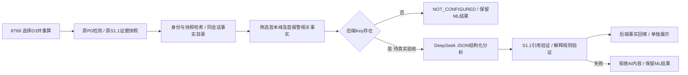

# S2 第一阶段：DeepSeek最小闭环准备报告（等待配置Key）

日期：2026-11-16（Asia/Hong_Kong）。范围仅D3真实异常检测解释，不扩展其余AI功能，不进入S3。

## 1. 当前结论

**无需密钥的准备、回归及缺Key降级验收已完成；真实DeepSeek调用和完整最小闭环尚未验收通过。**

当前后端进程的DEEPSEEK_API_KEY未配置，只检查是否存在，没有显示、读取到真实Key或代为申请Key。按照用户要求，停在真实调用之前等待配置。本轮真实DeepSeek请求数为0，没有真实模型解释、provider request ID、API Token用量、付费账单或真实调用成功截图；不得用测试替身或界面截图补充冒充这些交付物。

已完成独立S2 API客户端、D3输入摘要、严格解释合同、S1.1引用验证适配、审计、错误降级、8769独立AI区域和测试。全套81项通过；最后新增UTC审计字段后，28项S2测试再次通过。已有机器学习结果真实计算与保留，不依赖Key。

当前8769为无Key预览服务。配置Key后必须重新启动后端以继承环境变量，再继续一个真实案例的付费调用、引用核对与浏览器截图。现在不能宣称DeepSeek已经真实参与诊断。

## 2. 官方文档核对

本轮只浏览官方公开文档，没有拿Key试探接口或查询余额：

- [首次调用API](https://api-docs.deepseek.com/zh-cn/)：当前模型标识deepseek-flash，OpenAI兼容根地址https://api.deepseek.com。
- [Chat Completions API](https://api-docs.deepseek.com/zh-cn/api/create-chat-completion/)：POST /chat/completions，JSON响应格式及thinking开关。实现显式thinking.disabled、stream=false、max_tokens=1800。
- [JSON Output](https://api-docs.deepseek.com/zh-cn/guides/json_mode/)：提示词明确要求json并提供示例；空白、截断和格式错误仍需处理，合法JSON不代表事实正确。
- [错误码](https://api-docs.deepseek.com/zh-cn/quick_start/error_codes/)：认证、余额、限速、服务故障等需区分。当前仅明确429/503最多一次重试，不盲目重试认证/余额/校验错误。
- [模型与价格](https://api-docs.deepseek.com/zh-cn/quick_start/pricing/)：费用取决于实际Token、缓存和时段。本轮没有真实usage，不生成虚构成本。价格及模型别名可能变化，实际调用时仍以官方返回及账户账单为准。

使用标准库兼容HTTP，不安装SDK、不升级依赖。模型名从DEEPSEEK_MODEL配置；地址从DEEPSEEK_BASE_URL配置，允许官方HTTPS根地址及/v1兼容路径，拒绝其他域、HTTP、带凭据URL和重定向，避免Key被配置错误转发。

## 3. 新增架构与文件

没有修改任何已有文件，S1/S1.1全部源码和验收产物保持原样。S2实现位于新包 `src/causalverse/evidence_s2/`：

|文件|职责|
|---|---|
|__init__.py|独立S2边界|
|client.py|官方HTTP、环境Key、30秒socket超时、有限重试、JSON解析、错误脱敏|
|explanation.py|输入事实筛选、固定系统政策、语义验证、后端数值与中文释义回填|
|explanation_contract.json|独立结构化解释JSON合同|
|runtime.py|请求ID、UTC时间、延迟、usage、缓存/限流、校验及审计|
|gateway.py|在原S1.1 HTTP处理器外新增AI配置和解释路由，复用原会话归属和证据服务|
|protection.py|原8992、S1 572、S1.1 717及补充53项核验|
|console/index.html、app.js、style.css|从S1.1复制后独立维护的S2预览资源，原文件未改|
|console/ai.js|独立蓝色DeepSeek区域，状态、来源、用量及降级展示|
|README.md|密钥配置、启动、约束与复现说明|

新增测试 `s2_tests/test_deepseek.py`。独立验收批次为 `artifacts/ai_s2/s2_20261116_155131/`；新的运行批次为 `artifacts/ai_s2_runs/ca5e5af22d79311848d131be354fd8e0/`。新增文件完整SHA256清单在本批次new_files_inventory.json，清单自身摘要在inventory_seal.json。

调用关系：



S2不重新实现P0模型、身份、读取或Claim验证器。原S1.1 HTTP服务仍管理原会话及context，S2仅增加同会话专用CSRF和路由：GET /api/ai/session，POST /api/ai/explain。POST只接受context_id，不接收任意prompt、Key、上传数据或文件路径。

## 4. 真实数据与解释合同

只允许同会话的D3 context，检测必须INFERRED。先调用原service.get重新核对快照哈希，再读取原fact_catalog，仅筛选detection的DETECTION_METRIC事实。输入包含T²、SPE、Threshold score和两种Boolean报警的首/末/峰、首报警相关时刻，不发送全部原始轨迹、故障真实标签、种子、RNG、隐藏执行器或真实运行路径，也不发送故障分类和预测内容。

输入绑定context_id、snapshot_sha256、as_of和原payload_sha256。每条事实含原S1.1 fact_id、evidence_id和数值；原始数值由后端提供。发送前使用真实冻结模型结果，不能以历史检测档案或预设异常文本替代。

解释合同d3-explanation-1只允许2至8条findings，每条仅含rule与evidence_refs。允许的解释规则：

|rule|模型参与与后端校验|
|---|---|
|METRIC_EVIDENCE|模型选择值得解释的真实分数；后端要求单一数值事实，并回填指标、时刻、原值|
|ALARM_EVIDENCE|模型选择报警事实；后端要求Boolean原报警，不改变控制限|
|DETECTOR_AGREEMENT|模型选择PCA/Threshold对照；必须同一时刻、两种原报警，后端判定一致或分歧|
|TEMPORAL_CHANGE|模型选择发展对照；必须同指标、不同观测时刻的两个真实分数，后端回填原值，不虚构完整过程|
|INSUFFICIENT_ROOT_CAUSE|必须保留至少一项根因证据不足；统计检测不等于确定物理故障或因果路径|

每条引用只允许evidence_id、fact_id、payload_sha256；必须属于本次发送的事实子集，并通过原S1.1 resolve_claims再验证。客户端或模型不能输出新value、概率、任意pointer、根因标签、授权状态、自由诊断段落或执行指令。输出context/hash不符、额外字段、缺少局限项、引用错误和规则依据错误全部拒绝，不尝试用第二次模型生成修补事实。

**模型生成的是证据选择、解释类型与对照结构；中文释义及所有数值由后端受控渲染。** UI明确标记text_origin=BACKEND_VERIFIED_RENDERING，不把模板文字冒充DeepSeek自由撰写的回答。真实调用后须同时保存已验证的模型JSON，才能证明模型实际选择了哪些证据、如何组织解释；当前没有这项真实证据。

本最小合同仅支持直接观测到的模型输出及其统计对照，不支持正向统计关联、候选因果边或物理假设断言。模型若返回这些尚未注册的类型就拒绝，而不是包装成已验证结论。S1.1四种关系等级仍保留，但本轮未扩大关系证据范围。

## 5. 安全、超时、重试与审计

Key仅从后端进程DEEPSEEK_API_KEY取得用于Authorization头，不放入prompt、JSON响应、JS、日志或源文件。不保存上游错误body、任意未经验证文本或响应头；只保存严格验证后的引用型模型输出，防止原始错误文本意外带入敏感信息。拒绝重定向。对外错误为安全错误码，无堆栈或Key。

每次请求记录本地request_id、context/hash、配置模型、UTC发起时间、elapsed_ms、状态、实际是否发起API、provider响应ID（若合规）、usage白名单与费用状态。部分早期无Key预览审计产生在最后UTC/测试标记补充之前，缺少这两个新增字段；最终28项测试已验证新代码，配置Key后必须重启使用最终版本。旧记录未覆盖。

30秒为socket超时，不是保证整个网络请求在30秒内强制取消的全局时限。429/503最多重试一次，间隔0.5秒；超时、401/402、格式和证据拒绝不自动重试。请求体上限60KB、响应上限192KB、输出1800 tokens，防止无限上下文。单并发、30秒最小间隔，每进程最多10个逻辑请求；同会话同context成功结果复用。自动重试可能增加成本，跨进程限额不是持久预算。

模型名称和端点可配置，但不自动切换模型、换代理或降低验证门槛。API失败、输出无效、引用错误时analysis为空；原ML快照不变。Key缺失时在任何上游连接前返回NOT_CONFIGURED。

## 6. 前端实际验收

8769新增独立蓝色DeepSeek区域，与原机器学习卡片视觉分开。显示模型、配置/调用状态、请求ID和延迟；成功路径按验证后结构显示释义、原Claim事实引用、usage及不确定性。dirty、D511及缺Key时禁用调用；已有ML结果仍可查。

本次使用真实浏览器重新加载S2页面、选择D3并执行原模型。在1920×1080、1366×768、390×844三个视口保存截图及DOM：browser/*_missing_key.png、*_dom.txt。三者均显示：

“DeepSeek模型：deepseek-flash / NOT_CONFIGURED：后端缺少Key，未进行真实调用。机器学习结果继续可用。”

AI按钮均disabled，console warning/error=[]。这些是缺Key安全展示截图，**不是DeepSeek调用成功截图**。没有生成或填入伪造AI分析。

真实本机HTTP检查missing_key_live.json：context_id为b12d1cb61b98f946da40ccb48542e8e5，检测和三识别INFERRED，跨链预测UNAVAILABLE；AI状态NOT_CONFIGURED，api_call_made=false，analysis=[]，ml_evidence_unchanged=true。本地请求IDebc90805de6551e4991f9dc0c81eb47b不是DeepSeek provider ID；其中0.0132ms为无Key本地返回耗时，不能当成大模型响应延迟。

## 7. 测试结果与性质

|范围|结果|是否真实DeepSeek|
|---|---|---|
|原S1+S1.1 53项回归|通过|否，冻结数值模型与本机HTTP|
|S2新增28项|通过|否，真实ML事实+显式传输替身/拒绝测试|
|全套最终81项|81通过、0失败|不能据此宣布API实调成功|
|UTC审计及替身标记补充后S2复测|28通过|否|
|缺Key真实8769 HTTP|返回NOT_CONFIGURED，ML快照不变|未发上游请求|
|有Key真实API最小闭环|尚未执行|等待用户配置|

覆盖正常HTTP传输/正常结构化解析测试替身、Key缺失零网络、超时、HTTP401/402/429/500/503、有限重试及脱敏、无效ID/哈希、跨context、虚构数值、评分冒充概率、候选冒充确定根因、预测冒充观测、修改授权、提示词注入文本、自由字段/非法类型、缺少局限、格式错误/空白/重复JSON键、外部端点拦截，以及AI不可用时保持ML结果。

所有测试替身明确标为SYNTHETIC_TEST_FIXTURE，不具有真实API验收资格。最终审计还标记transport_mode=TEST_FIXTURE_ONLY、api_call_made=false、TEST_FIXTURE_STRUCTURED_SELECTION。早期测试产物的通用来源字段在发现后完善，新旧日志都保留；所有测试产物均排除出真实调用及成本统计。

首次81项运行：78通过、3项本机HTTP因沙箱WinError10013失败，tests_first.log/xml保留。允许回环访问后tests_network及tests_final全套81项通过；最后S2审计字段变更后tests_audit_time为28项通过。测试不读取真实Key，用隔离的合成环境值验证Authorization构造，未连接上游。

## 8. Token与成本

真实上游请求数：0。真实usage：不适用/尚未取得；不是测量到的0 tokens。真实API响应延迟：尚未测量。未产生本阶段API调用费用，没有账单验证。缺Key审计usage=null、cost_cny=null、cost_status=NO_CALL。

测试中的Token数字是传输替身，不计入真实统计。未来收到真实usage后记录原值，仍不得把估算价格伪装成账户扣费。当前保留usage并标记USAGE_RECORDED_INVOICE_NOT_VERIFIED，不自动猜测缓存/峰谷或输出虚构人民币金额。

## 9. 文件完整性

写前及准备完成后均直接使用原清单核验，见protection_before.json和protection_final.json：

|保护集合|expected/checked|本次意外变化/缺失/错误|
|---|---|---|
|原8992|8992/8992|0/0/0|
|原S1 572|572/572|0/0/0；仍承认已验收S1.1的5项历史授权迁移|
|S1.1 717|717/717|0/0/0；本轮全部原样保持|
|补充封存53|53/53|0/0/0|

unknown_files=[]。S1.1清单锚仍为7f11bae85ed67323499b54925236f44f6646a1a324299d5e6aabfb0859ab560c；原8992保护文件及572清单锚均未变。没有重新生成旧预期值，没有修改任何旧源文件或前端构建产物。8769仅从S1.1预览进程切换到新S2入口，旧证据目录保留，8768未触及。

## 10. 复现和继续条件

启动、测试与安全配置完整命令见 `src/causalverse/evidence_s2/README.md`。核心启动命令：

```powershell
$env:PYTHONPATH=(Resolve-Path src).Path
.\.research\venv-tep\Scripts\python.exe -B -m causalverse.evidence_s2.gateway
```

当前8769预览占用端口，配置Key后需要停止该预览并在继承新环境的终端重新启动；不要杀未知服务或改8768。建议用户本机终端用Read-Host -AsSecureString安全输入，再赋给当前后端进程的DEEPSEEK_API_KEY，不把Key写入代码、日志或聊天。终端设置不会自动更新已运行进程。

待用户配置并告知后，仍在S2授权内继续：只选择一个D3案例，重算并核对事实 → 显式触发真实DeepSeek请求 → 保存真实provider ID、usage、已验证模型JSON、Claim及后端回填 → 浏览器展示截图 → 更新验收结论。若真实输出不合格保留失败，不放宽合同，不以替身补结果。

## 11. 尚未完成与剩余风险

真实付费API网络、认证、余额、正常输出与合同兼容性尚未验收；真实Token、成本、延迟和生成结果暂无。当前受控结构化解释不是任意自然语言聊天，中文由后端释义，不宣称DeepSeek撰写全部文本。若竞赛展示需要自由自然语言生成，需在不放宽事实合同的前提下另行审定方案，不在缺Key时模拟展示。

本最小版采用非流式JSON，等待期间显示状态；没有实现流式token展示、长期任务取消、持久跨进程费用预算或生产TLS/账户体系。Key配置只来自后端进程，不支持浏览器填写。原支持域、宽区间、候选分歧和无优化授权边界全部保留。

S2尚未全部通过；本轮停在等待Key配置，不进入S3。
