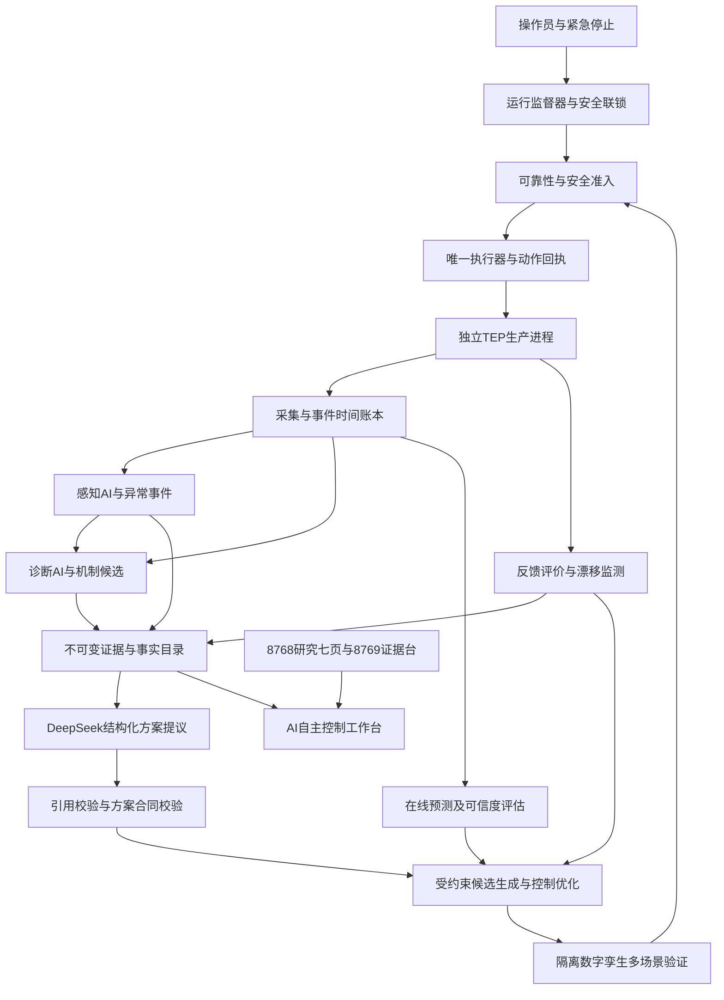

# CausalVerse竞赛版总体技术架构V3

日期：2026-11-16；性质：总体审计与待批准设计。项目根目录为 `D:/广西人工智能大赛`，下文代码路径均相对此目录。本文及配套七份文档不构成实施、仿真、训练、付费调用或控制执行授权。

## 1. 最终目标与当前结论

最终定位：**CausalVerse——基于人工智能的工业生产全流程自主监控与智能调节平台。** 以TEP连续化工过程为首个验证环境，建立感知、诊断、预测、决策、仿真验证、受约束执行和反馈循环。当前已完成冻结模型真实推理和一例DeepSeek证据解释，**尚未实现这一自主闭环**。

建议采用“两条预测路线、分层授权、单写入执行器”的架构。已验收Action/Delta保持研究对照和原拒绝结论；用于自主控制的在线预测、状态估计与可靠性合同另建版本、另做实验。不能把旧模型的 `optimization_allowed=false` 改成true，也不能用数字孪生的一条良好曲线抵消其区间失败。

V3取代旧规划中“下一步只做主平台AI展示融合”的后续路线，但保留所有旧文档和标签。S3—S7是本轮提出的新阶段定义；原规划中的S3/S4以及P0编号不据此追认已完成。

## 2. 已核实的TEP边界

|层面|实际能力与证据|不能推导的结论|
|---|---|---|
|过程引擎|`src/tep/python_backend.py`、`constants.py`：反应器、冷凝/冷却、气液分离器、汽提塔、循环压缩与进料/放空；50状态、8组分、13物流、41测量、12操纵通道|不包含整座真实工厂的仓储、排产、物流、设备维修和现场通信|
|本机运行路径|`src/causalverse/simulation/adapter.py` 固定Python后端、上游commit `9a6c8e5fcef4a2850778704e7793c87b0a187005`；逐步推进1仿真秒|不是已验收的硬实时系统；未取得Python/Fortran逐方程一致性证明|
|操作能力|reset/step/inject_fault/snapshot/restore/branch/set_control已实现；D2曾验收24小时正常运行、恢复一致和选择性动作|函数可调用不代表已有在线控制服务或安全授权|
|研究范围|现有因果、识别和干预研究主要围绕反应器—冷却回路，正常及IDV4/11/14|不能宣称五个单元均已完成AI自主控制|

41个测量中22个为连续测量、19个为有采样与延迟的组分测量。每秒读取41列不意味着所有通道每秒独立更新。12路命令是归一化操纵量；XMV10不是实际阀位，也不是冷却水流量。

## 3. 总体结构

图中的实时采集服务、自动事件编排、决策方案合同、控制优化、数字孪生服务、安全准入、执行服务及反馈评价均**未实现为完整业务链**。现有TEP函数和证据基础是复用资产，不是这些框已完成的证明。

## 4. 六类能力的责任边界

|能力|负责内容|首选复用|新增工作|
|---|---|---|---|
|感知AI|41列输入、质量状态、冻结PCA评分与统计阈值、异常事件|P0-01/02、原PCA/Threshold算法|实时数据身份、流式输入准入、调度与事件去重；新频率另验证|
|诊断AI|多方法候选、分歧、变量证据、关系等级|P0-03、Static/VAR/Logistic、D4逐边来源|未知起点的窗口协议与实验；新数据上的拒绝校验|
|预测AI|动作响应、域内判断、误差与不确定性|P0-04作为冻结对照|可滚动的控制预测器、状态估计、独立校准/验证|
|决策AI|读事实、提出目标/方案模板、组织证据与待验证假设|S1.1验证、S2客户端与审计|独立方案合同和校验；LLM不决定安全阈值或执行权限|
|控制AI工作层|受约束动作搜索、滚动计划与执行仲裁|TEP选择性覆盖、PI基线|真正的优化器、安全监督器、超时、租约、幂等回执与紧急停止|
|反馈验证AI|目标误差、恢复持续性、动作效果、重规划触发|真实测量、既有预测档案供对照|事前冻结评价器、失效监控和多轮策略|

技术归属必须准确：Threshold为统计规则，Static为统计签名匹配，PCA为数据驱动线性降维与统计监测，VAR为拟合时序模型，Logistic和Action/Delta为监督学习；MPC为模型优化控制，PI为常规反馈控制，DeepSeek为大语言模型。工作台不可把每个普通统计量、阈值或前端动画都称为机器学习推理。

## 5. 双路线与权限

**研究路线FROZEN_RESEARCH**：只读D3/D511注册数据，执行既有冻结合同；保持原身份、时间、校准、拒绝和授权false。继续用于回归、研究页和失败证据。

**在线路线LIVE_TEP_V1（拟议）**：独立实时运行身份、流式观测、在线合同和新证据目录。可引用旧参数哈希，不能冒用D3运行编号绕过白名单。新控制预测器及孪生验证通过独立资格评审前，`sim_execution_allowed=false`。即使后续获准TEP执行，`physical_execution_allowed=false`始终保持。

新证书需绑定运行/分支、观测前缀、预测器版本、控制策略、安全规范、有效时刻和允许动作集合；不能仅凭一个Boolean放行。旧 `optimization_allowed` 原样保存，新权限不能与旧失败属于同一方案却被解释为成功。旧模型不合格时，该路线的动作始终拒绝。

## 6. 部署与界面

第一版采用现有Python环境、多进程隔离和本机文件账本，不引入Kafka、云数据库或新Web框架。仿真进程独占TEP对象；LLM网络与分支计算不阻塞采集、安全监督和停止命令。8768/8769保持原样，拟另建自主工作台预览端口8770，实施前检查占用，不强占已有服务。

主工作台显示：数据模式/仿真钟/墙钟、AI阶段、41变量质量、报警、候选、预测区间、候选方案、安全拒绝、执行回执、调节前后变化及完整时间线。所有“正在执行”必须对应后台动作回执。研究七页和8769作为技术证据入口保留；不得把历史曲线混进实时曲线而省略来源。

## 7. 验证与演进

先实现S3实时只读监控，再做S4事件驱动诊断；S5完成新预测/孪生/控制算法资格，S6才接通TEP写入和持续反馈，S7进行盲测与现场演示。每阶段独立批准、冻结协议、保存失败和验收后停止。

MPC的优化、反馈与约束设计参考[作者教材](https://sites.engineering.ucsb.edu/~jbraw/mpc/index.html)；学习策略与独立预测安全过滤的分离参考[Wabersich与Zeilinger原论文](https://arxiv.org/abs/1812.05506)。本项目尚未具备这些文献的安全证明条件，不能把参考文献当作本系统稳定性证书。

详细差距见[能力审计](D:/广西人工智能大赛/CAUSALVERSE_CAPABILITY_GAP_AUDIT.md)，执行边界见[闭环设计](D:/广西人工智能大赛/REALTIME_AUTONOMOUS_CONTROL_DESIGN.md)，阶段门见[路线图](D:/广西人工智能大赛/S3_S7_IMPLEMENTATION_ROADMAP.md)。
