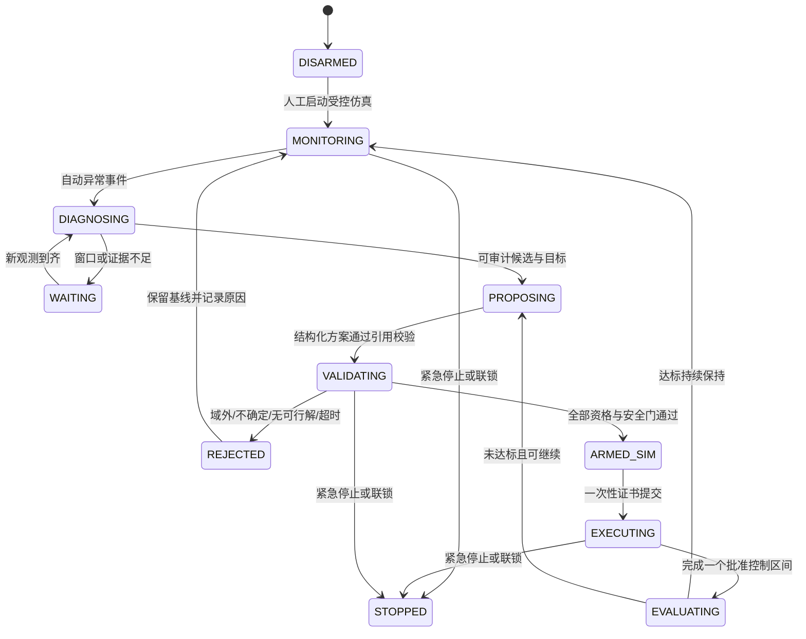

# 实时监控与自主控制闭环设计

日期：2026-11-16；未实施、未运行新仿真。适用目标首先限定本机TEP反应器—冷却回路；全厂推广是后续研究目标。工程路径相对 `D:/广西人工智能大赛`。

## 1. 现有执行语义必须保留

`src/causalverse/simulation/adapter.py` 的SelectiveController每秒调用原PI，再在动作区间替换指定输出，其他输出保持当步PI建议。`set_control` 接受1-based通道、[0,100]绝对命令、正整数时长，拒绝过去时刻和同路重叠动作。该函数没有自主决策、抢占撤销、斜率限制、证书或超时watchdog。

`experiments/d511_data.py` 的delta=0不调用set_control，表示继续PI；delta=1/5表示动作前命令加增量，绝对覆盖120秒。把delta=0做成固定命令会改变基线。命令取排程前真实get_control_variables，不用5390秒U10冒充5400秒命令。覆盖退出后恢复PI不等于已证明无扰切换或抗饱和。

适配器row中的 `t_seconds` 对应旧时刻方程求值/测量，`state_t_seconds` 是积分后状态；step结束读到的测量可能比当前步号落后一秒。在线账本必须保存两者，不能用step_count重新标记所有测量。额外evaluate可能消费随机数，不为“刷新读数”重复调用。

## 2. 三种时钟与运行调度

|时钟|用途|约束|
|---|---|---|
|仿真事件时间|模型as_of、窗口和动作起止|严格整数序列，不能回填未来或把加速播放称现实实时|
|墙钟|接口耗时、LLM延迟、任务截止和预算|使用单调钟计时，UTC记录审计|
|展示游标|历史回看、工作台选中位置|不能决定生产执行时钟或掩盖后台继续推进|

S3先支持实时倍率1和明确标记的加速仿真两种模式，分别记录实测real_time_factor。若机器算力不足，报告落后、背压或暂停新优化；不能丢观测后伪造匀速。仿真生产、分支推演和LLM各自进程/任务隔离，生产与执行器只有一个写入者。

采集记录原始1秒41列/12命令，10秒精确抽样供诊断/新预测，180秒原网格供冻结检测影子对照。19个组分通道的值可能为延迟采样持有值，记录新鲜度，不插值冒充新测量。异常事件策略另冻结版本，例如首个原PCA报警产生候选事件，连续报警确认可作为上层事件策略，不能改原严格大于及T² OR SPE逻辑。

## 3. 闭环状态机

STOPPED应当从所有活动状态均可达，图中只示典型入口。安全检查失效、非有限数据或数据源失联不得留在EXECUTING。模型拒绝时继续PI只表示回到原基线，不宣称故障下PI一定安全；接近硬边界或失去监控时停止仿真并锁定，不继续盲跑。

## 4. 预测与控制的两条研究路线

### 4.1 现有冻结路线：不能执行

原Action/Delta只有5400秒固定输入、6×7历史、三动作、120秒、六离散时域。全部480条件区间过宽，且保守支持通过仅2/240与12/240。该路线保持 `optimization_allowed=false`，不能滚动拼接成MPC，也不能把六检查点当连续600秒安全证明。

### 4.2 新仿真控制路线：先孪生搜索，再逐步建立可观测预测

第一步研究有限动作、同历史多场景前向搜索。候选优先为继续PI、XMV10命令+1/+5的120秒覆盖，仍须作为**新起点/多轮协议**重新验收；不因幅度相同继承旧授权。每120秒边界可重规划，区间内每秒监测、允许紧急停止，避免和现有不可重叠的120秒动作冲突。更短执行/正常抢占需新增执行合同及恢复瞬态实验。

若只比较一段固定动作，称有限动作预测搜索；只有明确定义未来动作序列、有限时域目标/约束并滚动执行首段，才称离散MPC。可从两段、每段三选项的9种序列进行pilot，预计600秒推演；这是待测规模，不是已经测得的时延。不得把上游economic_mpc示例作为真实求解器。

约束目标示意（参数未定，不构成可执行配置）：

`min_U max_s Σ_k (||y(k,s)-r||_Q² + ||Δu(k)||_R²) + terminal_cost`

所有目标、Q/R、阶段时域、目标带宽、动作范围、回退集合和场景集必须在验证前固定。硬约束不可用软罚分换取违反；不收敛或无可行解就拒绝。后续线性/非线性MPC可考虑现有SciPy做小规模原型，但SLSQP返回success不等于全局最优、递归可行或稳定性证明。

第三步在合法可观测量上建立新ARX/状态空间或机理加学习残差预测器，训练/验证/校准按完整episode分离，覆盖未知起点和多轮干预。需要新数据，可能需要新训练/校准；只新增版本，绝不重训覆盖旧Action/Delta。先比较简单辨识模型，只有独立收益才考虑更复杂网络或自适应模型。自适应参数仅在影子层更新，生产控制仍用已批准冻结版本。

MPC设计参考[Rawlings等作者教材](https://sites.engineering.ucsb.edu/~jbraw/mpc/index.html)，安全过滤责任分离参考[Wabersich与Zeilinger原论文](https://arxiv.org/abs/1812.05506)。本方案尚无递归可行、安全不变集或鲁棒误差界证明，不能据这些资料宣称已有理论保证。

## 5. 数字孪生与特权信息隔离

|模式|允许信息|可声称内容|局限|
|---|---|---|---|
|SIM_ORACLE_TEST|完整进程快照，仅受限孪生服务持有内部状态|同一TEP实现、特权状态下的控制算法上界/调试|不是传感器可部署方案，也不是独立真实工厂孪生验证|
|OBSERVATION_TWIN（目标）|截至当前的传感器/命令、估计状态、明确的扰动假设集合|已验证范围内的传感器驱动仿真预测|状态估计、隐变量、扰动与失配需独立验证|

现有snapshot包括RNG、故障计划、阀位与全部历史，branch复制成本随历史增长。不能把整个snapshot交给DeepSeek/诊断/策略；尤其不能把已排程的未来故障计划带入候选评分，造成先知决策。原branch用于完全配对的离线验证，与部署式候选推演分开。

新孪生fork应在隔离进程采用经过审核的未来扰动场景，并审计排除未公开未来故障计划；不能随意修改快照对象后仍称完全复原。若无法做到无泄漏，只允许标为SIM_ORACLE_TEST，不能通过可观测闭环验收。对于已生效的故障，策略使用所有保留候选或约定保守集合，不能从idv真值选择分支。

每个候选从同一输入前缀开始，包含继续PI对照；评估全1秒轨迹的安全约束，不只看六个时域点。副本不得修改生产对象、推进生产RNG或占用执行器。分支没有停机只是有限场景结果；同引擎预测与生产高度同源，必须另外加模型失配、未知未来扰动和状态估计误差压力测试，不能给出无条件安全概率。

## 6. 安全规范和执行屏障

原后端实际停机条件在 `src/tep/python_backend.py`：P7>3000kPa、T9>175°C，以及反应器/分离器/汽提塔内部液体容积超上下限。容积使用 `vlr/vls/vlc ÷35.3145`，不能把 `constants.py` 中液位阈值的%注释直接用于L8百分比。新的安全规范须逐项核对真实公式、单位及可观测转换，并在停机线内设工程裕量；本轮不设定未验证的新数值。

原停机是在方程求值/步进后的保护，不是执行前充分安全过滤。新后端屏障至少要求：

- 当前采样完整、有限、新鲜；episode/时钟匹配，未触发停止。
- 方案合同合法，command+delta及变化率/累计覆盖预算合法；无冲突动作。
- 控制预测资格、场景覆盖、失配/不确定性、完整轨迹硬约束和终端回退可行。
- 计算未超截止，执行证书未过期；生产状态变化使证书失效时重新计算。
- 唯一执行者、幂等action_id、执行前日志、命令读取回执与事后状态证据。

新 `sim_execution_allowed` 仅在新策略资格通过且用户批准TEP执行阶段后才可能为true；旧失败方案不能换字段绕过。`physical_execution_allowed=false`。策略无合格可信预测就拒绝动作，即使LLM高度肯定也无效。

紧急停止必须走独立高优先级通道；本机仿真选择暂停/停止推进并撤销尚未执行队列，不声称回滚已积分的物理状态。当前set_control没有撤销函数，S6需在新增执行包装层实现并专项验收，不能假设返回PI就能立即清除已排程覆盖。恢复须人工确认、重新建立前缀与资格，不自动续跑旧动作。

## 7. 反馈、恢复与边界

评价器按事前目标带与持续时间判恢复，不能仅用“一次PCA不报警”。计算温度/压力/液位的超调、积分绝对误差、约束违反、动作总变差、阀命令饱和、拒绝/停机次数和恢复时间；与同历史PI对照比较只能作为离线效果评估，未来PI真值不进入在线Delta/Base。

未恢复且证据有效：新context、新plan继续循环；改善不足、振荡、失配或达到最大轮数/时长：停止新增动作并进入已定义安全状态。必要时结果就是“无法安全恢复”，不通过取消故障注入、reset生产或删除失败日志伪造成功。执行后重新诊断受动作干预影响，不能继续套用只在a0历史验证的旧机制分类器。

验收要求至少两个完整决策周期、实际命令回执与后续观测；若首周期已恢复，可在独立压力场景验证多轮。所有异常停止路径、重复提交、断网/LLM超时、旧计划重放、抢占延迟和退出PI瞬态必须保留结果。
