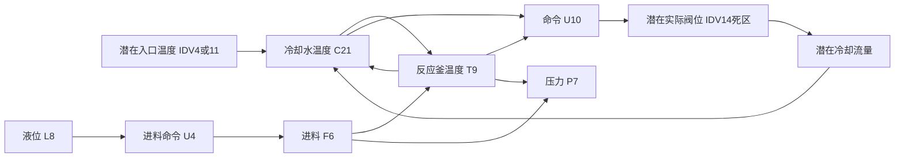

# D4 局部动态因果图

A为工艺约束图，B为时序候选预测图。未由PCA贡献生成因果边。全部边及依据保存于 artifacts/d4/process_graph.json；每条边标注类型、滞后、物理来源和实验状态。

图示为跨时间作用；实际模型只使用历史10..60s指向当前时刻，展开后为DAG，不把同一时刻反馈环硬塞进静态DAG。自回归历史边未在简图逐条画出。U10→C21为经未观测执行器/流量的约化路径，不是物理直接边。T9↔C21来自换热耦合；反馈边来自明确的控制算法；其他进料/液位/压力路径是受工艺知识限制的候选，不能因加入模型就称已识别。

|方法|本次工作|主要限制|
|---|---|---|
|静态相关|正常训练运行局部7变量相关矩阵|方向未知，反馈混杂|
|VAR|全历史父节点岭回归，验证集选阶数|预测性基线，闭环系数不是因果效应|
|Granger|各正常训练运行条件OLS F检验、每运行BH形式筛选，再统计跨运行出现率|自相关/遗漏变量下p值只作探索；不能声称校准FDR或物理因果|
|约束动态SEM|按process_graph父集合拟合，10s网格1/3/6阶选择|约化模型遗漏真实内部状态，独立外生误差未获证明|
|PCMCI/PCMCI+|阅读官方文档及GPL许可，比较假设，未运行软件基准|因果平稳、充分观测等假设在故障切换和闭环中存疑；不能自动解决隐藏入口温度|
|工艺知识图|核对原方程和控制器，有源依据|是先验，不是用于计算结构准确率的真值|

B结果以 granger_per_run_screen.json 为准，stable_candidate表示至少半数正常训练运行通过本次探索筛选；static_correlations.json保存相关矩阵。discovered_edges.json另保留最初的median-p探索汇总，其BH形式阈值不具有FDR保证，不用作确定因果结论。两套图的差异包括强自回归、反馈反向预测、代理变量与潜在中介。不得用A作标签给B计算“结构准确率”。

结构Precision/Recall/F1在TEP上记N/A；仅在单元测试已知7变量线性动态链的合成夹具中检验系数恢复，不能推广为TEP结构发现效果。

Tigramite为GPLv3（本地原许可和官方源码已查），本次未安装/复制/集成；未来若分发组合实现须保留版权、许可及满足适用源代码义务，独立环境本身不免除义务。[官方文档](https://jakobrunge.github.io/tigramite/)、[许可](https://github.com/jakobrunge/tigramite/blob/master/license.txt)。VAR/Granger解释参考[statsmodels官方说明](https://www.statsmodels.org/v0.12.2/vector_ar.html)。

## 每条约束边的证据

|边|性质与来源|干预状态|
|---|---|---|
|T9(t−10..60s)→T9(t)|历史状态；状态记忆/控制命令保持；离散历史项|未独立干预识别；保留待验证|
|C21(t−10..60s)→T9(t)|热耦合，观测含噪声；qur及釜体/水侧能量平衡|未独立干预识别；保留待验证|
|P7(t−10..60s)→T9(t)|候选约化间接路径，尚未单独识别；物料/能量/容积及进料路径；遗漏组分/状态可能混杂|未独立干预识别；保留待验证|
|L8(t−10..60s)→T9(t)|候选约化间接路径，尚未单独识别；物料/能量/容积及进料路径；遗漏组分/状态可能混杂|未独立干预识别；保留待验证|
|F6(t−10..60s)→T9(t)|候选约化间接路径，尚未单独识别；物料/能量/容积及进料路径；遗漏组分/状态可能混杂|未独立干预识别；保留待验证|
|T9(t−10..60s)→C21(t)|热耦合，观测含噪声；qur及釜体/水侧能量平衡|未独立干预识别；保留待验证|
|C21(t−10..60s)→C21(t)|历史状态；状态记忆/控制命令保持；离散历史项|未独立干预识别；保留待验证|
|U10(t−10..60s)→C21(t)|潜在阀位/流量中介的约化路径；阀门→冷却流量→水侧能量平衡|U10总路径的配对实验支持；不是该边独立效应|
|T9(t−10..60s)→P7(t)|候选约化间接路径，尚未单独识别；物料/能量/容积及进料路径；遗漏组分/状态可能混杂|未独立干预识别；保留待验证|
|P7(t−10..60s)→P7(t)|历史状态；状态记忆/控制命令保持；离散历史项|未独立干预识别；保留待验证|
|L8(t−10..60s)→P7(t)|候选约化间接路径，尚未单独识别；物料/能量/容积及进料路径；遗漏组分/状态可能混杂|未独立干预识别；保留待验证|
|F6(t−10..60s)→P7(t)|候选约化间接路径，尚未单独识别；物料/能量/容积及进料路径；遗漏组分/状态可能混杂|未独立干预识别；保留待验证|
|L8(t−10..60s)→L8(t)|历史状态；状态记忆/控制命令保持；离散历史项|未独立干预识别；保留待验证|
|F6(t−10..60s)→L8(t)|候选约化间接路径，尚未单独识别；物料/能量/容积及进料路径；遗漏组分/状态可能混杂|未独立干预识别；保留待验证|
|U4(t−10..60s)→L8(t)|候选约化间接路径，尚未单独识别；物料/能量/容积及进料路径；遗漏组分/状态可能混杂|未独立干预识别；保留待验证|
|F6(t−10..60s)→F6(t)|历史状态；状态记忆/控制命令保持；离散历史项|未独立干预识别；保留待验证|
|U4(t−10..60s)→F6(t)|候选约化间接路径，尚未单独识别；物料/能量/容积及进料路径；遗漏组分/状态可能混杂|未独立干预识别；保留待验证|
|T9(t−10..60s)→U10(t)|控制算法反馈，非工艺正向作用；controllers.py ctrl10/18 闭环反馈|未独立干预识别；保留待验证|
|C21(t−10..60s)→U10(t)|控制算法反馈，非工艺正向作用；controllers.py ctrl10/18 闭环反馈|未独立干预识别；保留待验证|
|U10(t−10..60s)→U10(t)|历史状态；状态记忆/控制命令保持；离散历史项|未独立干预识别；保留待验证|
|L8(t−10..60s)→U4(t)|控制算法反馈；controllers.py ctrl17→ctrl4液位串级|未独立干预识别；保留待验证|
|U4(t−10..60s)→U4(t)|历史状态；状态记忆/控制命令保持；离散历史项|未独立干预识别；保留待验证|
