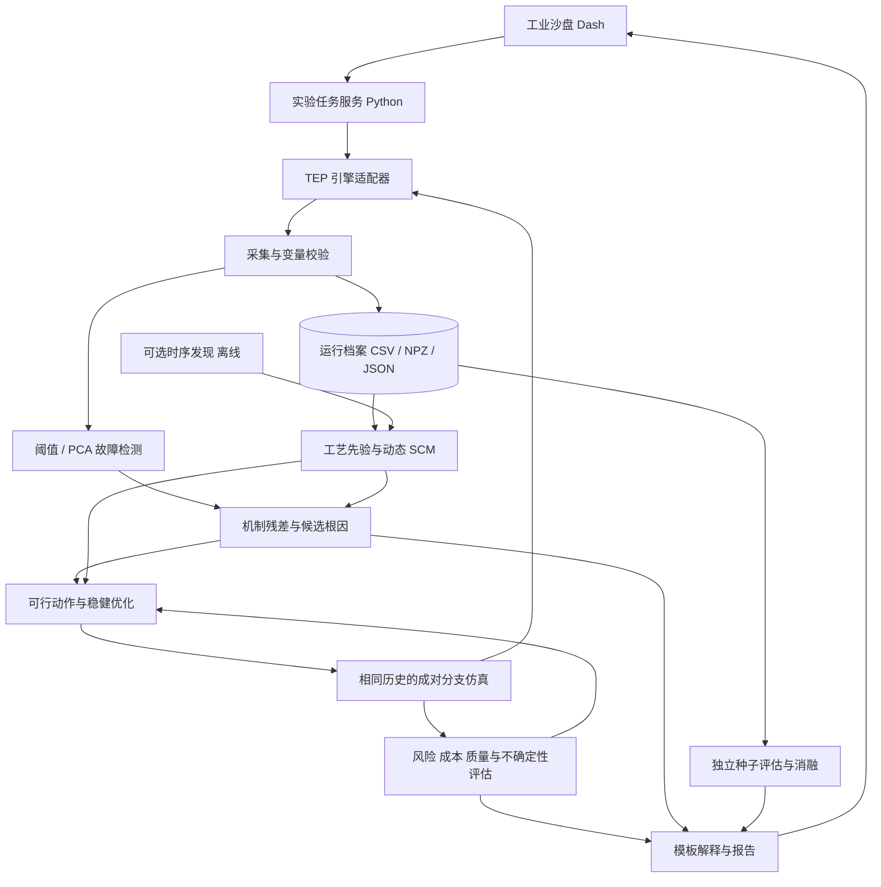

# CausalVerse 技术架构与选型

研究基准日：2026-11-14（香港时间）。这是待开发的系统方案；实际已完成的运行验证见 [开源调研](OPEN_SOURCE_RESEARCH.md)。本阶段不建设生产业务系统。

## 1. 最小可交付架构

优先组合：**TEP Python 后端 + DoWhy 0.14 + scikit-learn PCA + 自研动态 SCM/稳健干预选择 + Dash/Plotly/Cytoscape**。PyRCA 作为隔离环境中的对照；Tigramite 作为可选离线研究。选择依据及许可例外见 [调研报告](OPEN_SOURCE_RESEARCH.md)。

数据流与信任边界：

真实故障标签、内部状态和扰动入口供评估器使用；在线诊断只读允许的观测和控制历史。不得把 IDV 真值偷偷输入诊断器。

## 2. 模块与接口契约

|模块|职责/输入输出|复用与自主开发边界|
|---|---|---|
|仿真|reset(config)、step(action)、read()、branch(history)|复用 TEP 数值模型；自研稳定接口、后端版本检查|
|采集|41 测量+12 控制、质量掩码、时间戳|复用 NumPy/pandas；自研单位与变量模式校验|
|检测|正常训练数据→T²/SPE；在线窗口→异常分数|PCA/阈值先复用；阈值从验证集标定|
|因果模型|工艺边、时滞、机制模型及假设清单|DoWhy GCM；时间展开、边约束和工艺审核自研|
|根因|机制残差、传播路径→候选及不确定性|DoWhy anomaly 相关能力可评估；动态排序与故障入口映射自研|
|反事实|历史证据→噪声后验→替换控制策略→轨迹|DoWhy whatif；动态递推、状态重放与外生噪声配对自研|
|优化|候选动作、场景集→可行集/Pareto/推荐或拒绝|先离散网格；必要时 SciPy differential_evolution；风险目标与筛选自研|
|沙盘|设备状态、时间线、因果图、方案对比|复用 Dash 与现有 TEP 仪表盘交互模式；新增推演视图|
|解释|结构化证据→Markdown/HTML|模板优先；LLM 只润色已计算内容，不更改指标|
|实验|冻结配置→轨迹、指标、审计记录|全部自研实验编排，依赖成熟指标与绘图库|

建议 run_manifest：schema_version、run_id、engine_commit、backend、seed、initialization、dt、sample_interval、controller、fault_schedule、action_schedule、model_hash、split、termination_reason、artifact_sha256。每条观测保存 t_seconds 与原始变量名，内存数组索引统一为 0-based，公开 XMEAS/XMV 为 1-based。

接口中的 branch 不是只复制 50 维状态：还包括 RNG 状态、分析仪延时缓存、扰动随机游走、阀门状态、PI 积分器、调度器和仿真时钟。初期用完整对象深拷贝做能力验证，正式适配器采用可校验快照或相同历史重放。相同种子本身不保证干预后外生事件一致，必须检查 RNG 消耗路径；需要时外置扰动轨迹。

## 3. 因果实现约束

闭环控制产生反馈。以 X(t-τ)→X(t) 的展开 DAG 承载 DoWhy；同一时刻存在代数反馈时不能硬塞成 DAG。先固定物理方向和最小时滞，再用正常稳态数据估计机制。工况切换/故障窗口分开建模，相关系数和 Granger 预测关系只作线索。

效应估计的第一条可验证路线是：在相同故障背景下，对多个独立仿真运行随机分配有限动作，使用预动作状态作为基线，估计干预对未来温度偏差积分的平均影响。DoWhy 显式识别 estimand 并估计，与成对仿真均值差交叉核验。若使用观测闭环数据，则另列顺序可忽略性、充分历史、正值性和模型正确性假设；普通一次 backdoor 回归不能自动处理时变混杂。

个体反事实仅在选定可逆 SCM/外生噪声假设下定义；DoWhy 的 API 能计算不意味着真实工艺的个体反事实已识别。真实仿真状态分支是数字过程内部的机制干预证据，不能推广成现实工厂因果证明。

## 4. 技术与部署约束

- Windows CPython 3.12 独立 `.research/venv-tep` 已用于调研；正式开发环境另建并锁定可运行版本，避免直接跟踪 main。
- 主服务先用 Python 单应用 + 进程工作池 + 本地文件档案，不引入微服务、消息总线、云数据库。Dash 回调只提交任务和读取进度，长仿真不得阻塞 UI。
- PyRCA 环境优先 Python 3.10、NumPy 1.x、scikit-learn 1.1.x；单独安装验证后用 CSV/JSON 交换结果。当前主环境的现代 sklearn 与 PyRCA `<1.2` 不兼容，不能强行共装。
- Tigramite/Causal-TS 的 GPL 分发边界必须先决定。单独环境是依赖隔离措施，不自动免除 GPL 对组合分发的义务。阶段版可不集成，只保留离线可复现研究结果。
- TEP Python 源码运行可绕过现有打包缺陷；交付前需带来源声明建立自有适配包并修正构建配置，或安装编译工具。Rust 后端需另过构建与控制接口验收后再替换。

## 5. 工业沙盘方案

以反应釜—冷却回路为视觉中心：管线、反应釜、冷却阀、温压仪表和报警覆盖层组成主视图；右侧为根因证据与因果路径，下方为真实时间线和多方案轨迹。通过 Dash CSS/HTML 或审计后的 SVG 资产组织布局；曲线使用 Plotly，因果网络使用 dash-cytoscape。先复用 [TEP dashboard](https://github.com/jkitchin/tennessee-eastman-profbraatz/blob/master/src/tep/dashboard_dash.py) 的数据交互，不照搬所有组件或原项目品牌。

颜色与状态含义固定；动作输入显示单位、执行窗口、成本和约束。每个方案同时显示对照曲线、区间、失败/停机状态与证据等级。仿真时间和墙钟时间独立展示。点击设备可定位到相关变量和边假设。首版报告导出 HTML/Markdown；PDF 在核心验证通过后增加。

这是一份界面设计规格，当前没有实现或声称通过可视化验收。

## 6. 来源

- [TEP simulator API](https://github.com/jkitchin/tennessee-eastman-profbraatz/blob/master/src/tep/simulator.py)、[controller](https://github.com/jkitchin/tennessee-eastman-profbraatz/blob/master/src/tep/controllers.py)。
- [DoWhy GCM whatif 源码](https://github.com/py-why/dowhy/blob/main/dowhy/gcm/whatif.py)、[DoWhy 官方文档](https://www.pywhy.org/dowhy/)。
- [PyRCA 安装依赖](https://github.com/salesforce/PyRCA/blob/main/setup.py)。
- [Dash](https://github.com/plotly/dash)、[Cytoscape 示例](https://github.com/plotly/dash-cytoscape/blob/main/usage.py)。
